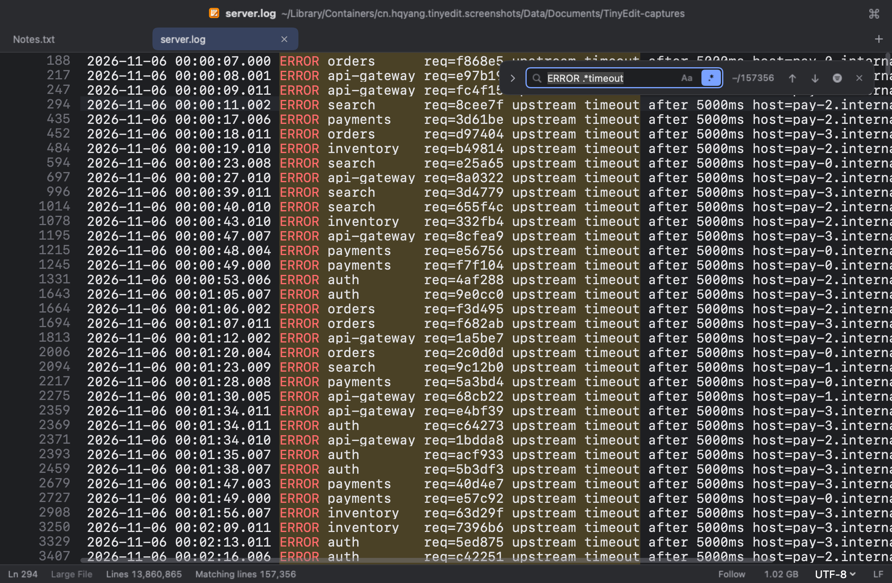
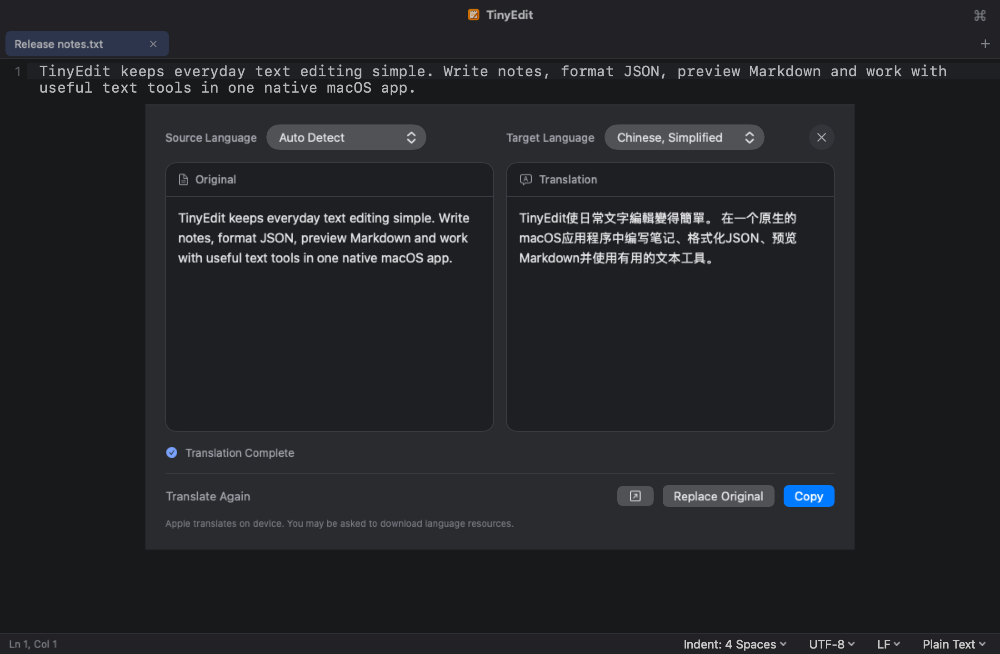
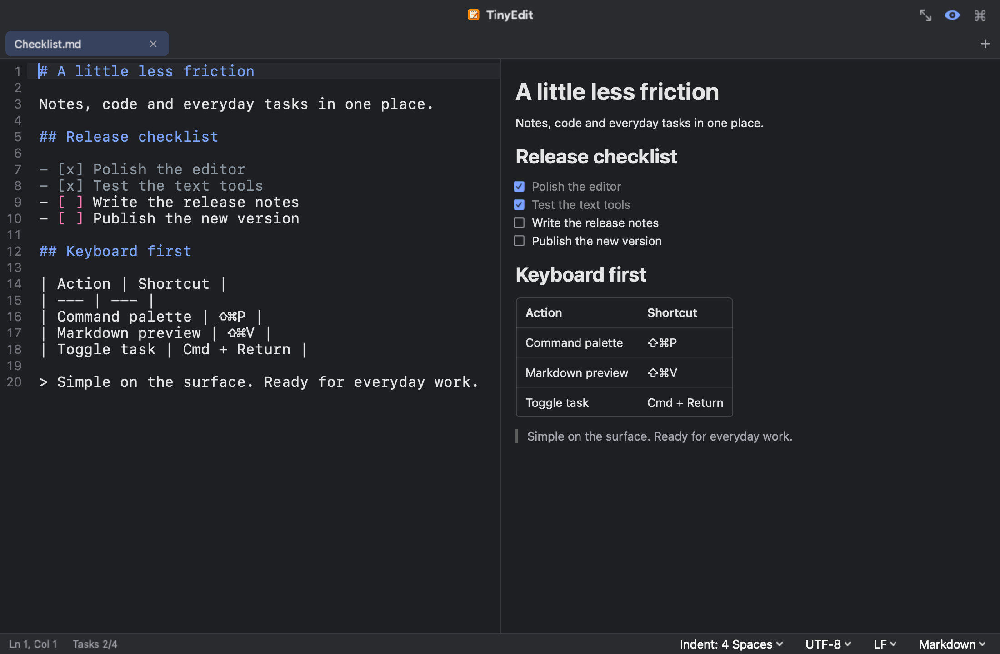

# TinyEdit

[简体中文](README.md) | **English**

TinyEdit is a **native macOS text editor** for everyday reading and editing of TXT, Markdown, JSON and other text files, and it opens multi-gigabyte logs in an instant.

Open a file to edit it, or start typing without creating a file first. Tabs and unsaved text are kept automatically, ready for the next launch. Built-in tools cover JSON, text recognition from images, arithmetic and translation, with a sidebar for browsing local folders.

For a quick tour, see the [introduction page](https://yanghanqing.github.io/tinyedit/), with screenshots of the main features.


## Features

Screenshots use the English interface and dark theme. Both language and appearance can be changed in Settings.

### Editing and files

| Feature | Description | Image |
| --- | --- | --- |
| Everyday editing | Tabs (pin the ones you keep, close every unmodified tab at once, Save All with ⌥⌘S), find and replace (with regular expressions), word wrap, line numbers, indent guides, matching brackets and selected-word highlighting. Duplicate, move, delete and join lines, or toggle comments. |  |
| Syntax highlighting | 36 languages and formats, including JSON, Markdown, Python, JavaScript, TypeScript, Swift, SQL and YAML, with automatic detection and manual selection. |  |
| Large files | Open multi-gigabyte logs and data exports directly: text appears at once, scrolling stays smooth, and memory use does not grow with the file. Jump to any line, search the whole file (regular expressions too), or show only the matching lines and double-click one to see it in place. Follow a log that is still being written, like `tail -f`. To change a few lines, select them and press Return; the file changes only when you save.<br><br>Measured on a 1 GB log of 11 million lines: text shows 0.04 s after opening, the whole file is read in under a second, a full search takes about a second, and memory stays around 20 MB. |  |
| Session recovery | Tabs, unsaved text, cursor and scroll position are kept automatically. Recovery data is separate from your files; files change only when you save them. |  |
| Files and encodings | UTF-8, UTF-16 and GB18030 (including GBK / GB2312), with line endings preserved. External file changes and deletions prompt you to choose what to do; reloaded changes are marked beside the line numbers. |  |
| Folders and windows | Folders open in separate windows, with a sidebar that updates as files change on disk. Drag tabs out to create windows or move them between windows. Each window's tabs, folders and position are restored at the next launch. |  |
| Finder preview | Select a file in Finder and press Space to preview rendered Markdown or highlighted JSON and code. Single-line JSON is formatted automatically. Markdown images appear as alt text. A large file previews its beginning, at once. |  |
| New file from Finder | Right-click empty space in a Finder window and choose New Text File with TinyEdit: a new tab opens, and saving it puts the file in that folder. Turn it on first from Settings ▸ General ▸ Finder Menu, which opens the system setting. |  |
| Appearance and languages | Light, dark or system appearance, multiple app icons and editor backgrounds, and eight interface languages, including English, Simplified and Traditional Chinese, and Japanese. |  |

### Text tools

| Feature | Description | Image |
| --- | --- | --- |
| Recognize pasted content | Paste Base64, JWTs, URL encoding, Unicode escapes or JSON strings to preview decoded text, then copy it or replace the original. Unix timestamp conversion is also supported. Terminal color codes and invisible characters prompt a cleanup suggestion. |  |
| Text from images | Paste a screenshot or drop a picture to insert its text. Recognition runs locally. On macOS 26, optional table recognition produces tab-separated text ready to paste into a spreadsheet. |  |
| Arithmetic as you type | Type an expression to see the result at the end of the line, then press Tab to insert it. Supports arithmetic, powers, roots, percentages and more; `0.1 + 0.2` gives exactly `0.3`. Select several numbers to see their sum in the status bar and click to copy it. |  |
| Translation | Read the original and translation side by side, for a selection or a whole document. Use Apple Translation or an OpenAI-compatible hosted service or local model. Long texts are split into segments, and interrupted translations can continue. Copy the result, replace the original or open it in a new tab. |  |
| Send curl requests | Paste a curl command, review the request and click Send. The response card shows status, time, body and headers, with JSON formatted automatically. Copy the result, replace the command or open it in a new tab. |  |
| Text comparison | Compare two tabs, or a tab with a file on disk, and navigate between changes. Differences in encoding, line endings and the final newline are shown separately. Available from a tab's context menu or the command palette. |  |
| Command palette | Press ⇧⌘P to find commands or switch tabs. Tools include JSON operations, encoding and decoding, line sorting and deduplication, and text cleanup. The palette suggests actions for the current content and dims commands that do not apply. Text tools use the selection, or the whole document when nothing is selected; changes can be undone. |  |

### Markdown

| Feature | Description | Image |
| --- | --- | --- |
| Side-by-side preview | Press ⇧⌘V to read source and preview side by side, or enable preview by default. Supports headings, lists, quotes, tables, code blocks and images, including images inside tables and HTML `` sizing. |  |
| Tasks | Write tasks with `- [ ]`, then click a preview checkbox or press ⌘↩ to toggle completion. The status bar tracks progress, and Return continues the list. |  |

### JSON

| Feature | Description | Image |
| --- | --- | --- |
| Paste and format | Paste JSON into an empty tab, or replace the whole document, to get a syntax and formatting suggestion. Formatting preserves key order and numbers as written. Minify, escape and unescape tools are also available. |  |
| Copy values and preview images | Place the cursor on a key or value to copy its path, key or value and see object key counts or array item counts. Copied strings are unescaped. Image links and embedded images can be previewed, copied or saved. |  |
| Inline annotations and link tools | See dates for timestamps, color swatches and JWT expiry status at the end of a line. Open links, decode content or expand URL query parameters into JSON. |  |
| Open Value | Open an object, array or ordinary string in a new tab to read longer values separately. Strings are unescaped, and JSON objects or arrays stored inside them are formatted automatically. |  |

## Command line

The bundled `tinyedit` command opens files and folders, jumps to a line or reads piped text.

In Settings ▸ General ▸ Command Line Tool, click Copy and run the install command in Terminal (an administrator password is required). The command stays current when TinyEdit updates, with no need to reinstall it.

```sh
tinyedit notes.md             # open a file; create it empty if it does not exist
tinyedit .                    # open the current folder in a new window
tinyedit main.swift:120       # jump to line 120; main.swift:120:5 also specifies a column
curl -s https://api.example.com/items | tinyedit   # view command output in a new tab
```

Files opened from the command line or Finder select an existing tab when available, otherwise open in the window whose workspace folder contains them, or in the main window for other files. For a batch of files, the first file's window comes to the front. Open and drag-and-drop actions inside a window use that window.

Piped text also supports language detection, JSON formatting and terminal color code cleanup; piped text without file arguments opens in the main window. Run `tinyedit -h` for all options.

## Download and install

Download the latest version from [Releases](../../releases) (or from the [introduction page](https://yanghanqing.github.io/tinyedit/#download)) and drag TinyEdit into Applications.

- macOS 14 or later, on Apple silicon or Intel Mac.
- Apple Translation requires macOS 15; table recognition in images requires macOS 26.
- No file size limit: files up to 16 MB open in the editor (above 2 MB only visible text is highlighted; above 5 MB highlighting and Markdown preview are off), larger ones in the large-file view.

## Privacy and network access

TinyEdit collects no user data. Editing, text recognition, text tools and session recovery run locally. Apple Translation runs on your Mac; the first use of a language may require a language pack download.

Custom-model translation sends the text to the configured service, or to a local service when using a local model. curl requests are sent when you click Send. Remote images are downloaded when you choose to load them.

## Build from source

Install Xcode 27 or later and XcodeGen. Run `xcodegen generate` from the repository root, open `TinyEdit.xcodeproj` and run the **TinyEdit** scheme.

## License

GNU General Public License v3.0 (GPL v3).
