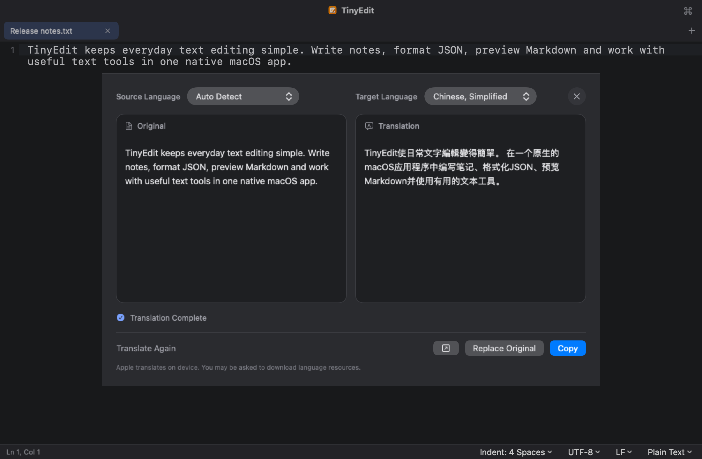
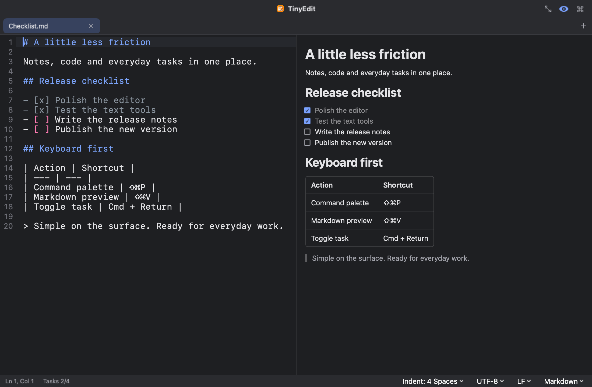

# TinyEdit 极简编辑器

**简体中文** | [English](README.en.md)

TinyEdit 是一款 **macOS 原生文本编辑器**，用于日常阅读和编辑 TXT、Markdown、JSON 等文本文件。

打开文件即可编辑，也可以直接输入内容，无需先新建文件。标签页和未保存的文本会自动保留，退出后再次打开即可继续。编辑器内置 JSON 工具、图片文字识别、随手计算和翻译，侧边栏支持浏览本地文件夹。


## 功能一览

以下截图使用英文界面和深色主题，界面语言与外观均可在设置中切换。

### 编辑与文件

| 功能 | 介绍 | 图片 |
| --- | --- | --- |
| 日常编辑 | 多标签页、查找替换、自动换行、行号、缩进参考线、括号配对和选中词高亮。支持按行复制、移动、删除、合并及切换注释。 |  |
| 语法高亮 | 支持 JSON、Markdown、Python、JavaScript、TypeScript、Swift、SQL、YAML 等 36 种语言和格式，可自动识别，也可手动切换。 |  |
| 自动恢复 | 保留标签页、未保存文本、光标和滚动位置。恢复内容与原文件分开存储，只有主动保存时才修改原文件。 |  |
| 文件与编码 | 支持 UTF-8、UTF-16、GB18030（兼容 GBK / GB2312），保留换行格式。文件被其他应用修改或删除时会提示，重新加载后标出变化的行。 |  |
| 文件夹与窗口 | 文件夹在独立窗口中打开，侧边栏随磁盘变化自动刷新。标签页可拖出为新窗口，也可移至其他窗口；各窗口的标签页、文件夹和位置会在下次启动时恢复。 |  |
| Finder 预览 | 在 Finder 中选中文件后按空格，可查看 Markdown 渲染、JSON 和代码高亮。单行 JSON 会自动排版，Markdown 图片以替代文字显示。 |  |
| 外观与语言 | 支持浅色、深色和跟随系统，提供多款应用图标与编辑区背景，以及简繁中文、英语、日语等八种界面语言。 |  |

### 文本工具

| 功能 | 介绍 | 图片 |
| --- | --- | --- |
| 自动识别粘贴内容 | 粘贴 Base64、JWT、URL 编码、Unicode 转义或 JSON 字符串后，可预览解码结果并复制或替换原文；也支持 Unix 时间戳转换。含终端颜色代码或不可见字符的文本会提示清理。 |  |
| 图片文字识别 | 粘贴截图或拖入图片，将识别出的文字插入编辑区。识别在本机完成；macOS 26 上还可启用表格识别，将结果作为制表符分隔的文本粘贴到表格软件。 |  |
| 随手计算 | 输入算式，行尾即显示结果，按 Tab 插入。支持四则运算、乘方、开方、百分比等，`0.1 + 0.2` 可精确得到 `0.3`。选中多组数字时，底部栏还会显示总和，点击即可复制。 |  |
| 翻译 | 并排查看原文与译文，支持选区和整篇文档。可使用 Apple 系统翻译，或兼容 OpenAI 接口的云端服务和本地模型；长文本分段处理，中断后可继续。译文可复制、替换原文或在新标签页打开。 |  |
| curl 请求 | 粘贴 curl 命令，查看请求信息后点击 Send 发送。响应卡片显示状态码、耗时、正文和响应头，JSON 自动格式化；结果可复制、替换原命令或在新标签页打开。 |  |
| 文本比较 | 比较两个标签页，或比较标签页与磁盘上的文件，查看并跳转到各处差异。编码、换行格式及末尾换行的差异也会单独提示。可从标签页右键菜单或命令面板进入。 |  |
| 命令面板 | 按 ⇧⌘P 搜索命令或切换标签页。提供 JSON、编解码、行排序与去重、文本清理等工具，并根据当前内容推荐操作，将不适用的命令置灰。文本工具优先处理选区，未选中时处理整篇文档；修改可以撤销。 |  |

### Markdown

| 功能 | 介绍 | 图片 |
| --- | --- | --- |
| 并排预览 | 按 ⇧⌘V 并排查看正文与预览，也可设置为默认显示预览。支持标题、列表、引用、表格、代码块和图片，包括表格内图片及 `` 尺寸设置。 |  |
| 待办事项 | 使用 `- [ ]` 记录待办，点击预览中的方框或按 ⌘↩ 切换完成状态。底部栏显示完成进度，按回车可继续添加下一项。 |  |

### JSON

| 功能 | 介绍 | 图片 |
| --- | --- | --- |
| 粘贴与格式化 | 将 JSON 粘贴到空白标签页，或替换整篇内容后，会提示切换语法并格式化。格式化保留键的顺序和数字原样，也支持压缩、字符串转义与还原。 |  |
| 快捷取值与图片预览 | 将光标放在键或值上，可复制路径、键和值，并查看对象字段数或数组项数。字符串复制时会还原转义；图片链接和内嵌图片可直接预览、复制或保存。 |  |
| 行末提示与链接工具 | 在行末查看时间戳日期、颜色和 JWT 到期状态；支持打开链接、解码内容，以及将 URL 查询参数展开为 JSON。 |  |
| Open Value：单独打开值 | 将对象、数组或普通字符串在新标签页中打开，便于查看较长的内容。字符串会还原转义，其中包含的 JSON 对象或数组会自动格式化。 |  |

## 命令行

TinyEdit 自带 `tinyedit` 命令，可打开文件和文件夹、跳转到指定行，或接收管道输入。

在 设置 ▸ 通用 ▸ 命令行工具 中点击“拷贝”，将安装命令粘贴到终端运行（需要管理员密码）。安装后，命令会随应用更新，无需重新安装。

```sh
tinyedit notes.md             # 打开文件；不存在时创建空文件
tinyedit .                    # 在新窗口中打开当前文件夹
tinyedit main.swift:120       # 跳到第 120 行；也支持 main.swift:120:5 指定列
curl -s https://api.example.com/items | tinyedit   # 在新标签页中查看命令输出
```

管道输入同样支持语言识别、JSON 格式化和终端颜色代码清理。运行 `tinyedit -h` 查看全部用法。

## 下载与安装

在 [Releases](../../releases) 页面下载最新版本，将 TinyEdit 拖入“应用程序”文件夹。

- 支持 macOS 14 或更高版本，兼容 Apple 芯片和 Intel Mac。
- Apple 系统翻译需要 macOS 15，图片中的表格识别需要 macOS 26。
- 单个文件最大 64 MB；超过 2 MB 时仅高亮可见区域，超过 5 MB 时关闭语法高亮与 Markdown 预览。

## 隐私与联网

TinyEdit 不收集用户数据。文本编辑、图片文字识别、文本工具和内容恢复均在本机完成。Apple 系统翻译在本机运行，首次使用某种语言时可能需要下载语言包。

使用自定义模型翻译时，待翻译文本会发送至设置的服务地址；使用本地模型时，发送至本地服务。curl 请求在点击 Send 后发送，远程图片在主动加载时下载。

## 从源码构建

安装 Xcode 27 或更高版本及 XcodeGen，在仓库根目录运行 `xcodegen generate`，然后打开 `TinyEdit.xcodeproj`，选择 **TinyEdit** scheme 运行。

## 许可证

GNU 通用公共许可证第 3 版（GPL v3）。
